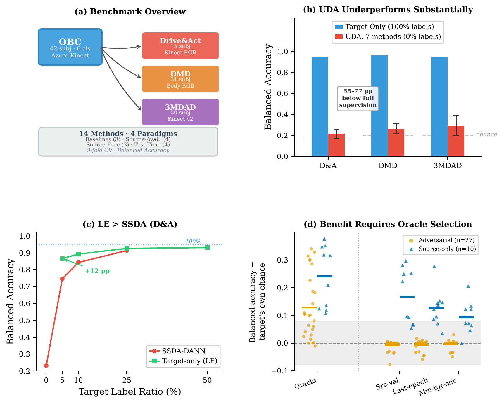

# A Cross-Dataset Benchmark for Driver Behavior Recognition

Code, data splits, per-run results and analysis scripts for

> Jisu Kim and Byoung-Keon Daniel Park, "A Cross-Dataset Benchmark for Driver Behavior Recognition: Evaluating Domain Adaptation under Strong Pretrained Video Representations," *IEEE Access*, 2026 (accepted for publication).



## Summary

The benchmark unifies four driver monitoring datasets under a shared six-class taxonomy (drinking, phone call, phone texting, reaching, adjusting controls, seatbelt). OBC (proprietary, UMTRI) is the labeled source, and Drive&Act, DMD and 3MDAD are the targets. Fourteen methods are evaluated on a VideoMAE-Base backbone pretrained on Kinetics-400: three baselines (Source-Only, Target-Only, Fine-Tune), four source-available DA methods (DANN, CDAN, MCC, BNM), three source-free DA methods (SHOT, CleanAdapt, C-SFDA) and four test-time adaptation methods (BN-Adapt, TENT, LN-Ent, ViTTA), together with a semi-supervised label-ratio sweep and a 107-run campaign on source composition and checkpoint selection.

Main findings:

1. Unsupervised DA collapses toward chance on every target (0.17 to 0.40 balanced accuracy), while the same backbone exceeds 0.94 with full target supervision.
2. The apparent benefit of adversarial adaptation appears only when checkpoints are selected with target labels; under every label-free selection rule the adversarial runs sit at or below chance.
3. A linear probe on frozen Kinetics-400 features recovers about 94% of full fine-tuning accuracy, so the dominant failure is classifier calibration rather than representation damage.
4. Labeling about 10% of the target data outperforms adversarial adaptation regardless of source composition.

## Repository layout

| Path | Contents |
|---|---|
| `code/cross_dataset/` | Dataset loaders, backbones, class mapping (`class_mapping.json`), training and evaluation entry points (`train_cross.py`, `train_sfda.py`, `eval_tta.py`, `eval_source_only.py`, `eval_linear_probe.py`), data preparation scripts, statistical tests (`stat_tests_extended.py`) |
| `code/cross_dataset/annotations/` | Subject-disjoint split definitions: Drive&Act fold CSVs, and per-clip labels with fold assignments for DMD and 3MDAD (clip identifiers only, no video content) |
| `code/cross_dataset/paper/` | Figure generators for the paper, with the inputs of Fig. 2 and Fig. 5 |
| `configs/` | Label-space definitions (six-class, and the five-class space without seatbelt used by E4) and the OBC source definition |
| `manifests/` | Frozen source manifests of the constructed sources (Rand-573 = `da573_random.csv`, Broad-573, Narrow-573) and the full fold-0 training manifests. The files are byte-exact copies of the frozen originals, so `cd manifests && sha256sum -c MANIFESTS.sha256` reproduces the hashes recorded in `PREREGISTRATION.md`. The `video_path` column keeps the original storage paths and is not read by the trainer, which uses the `row` index |
| `results/` | Per-run result summaries of 659 training and evaluation runs, plus `results/analysis/master_results.csv`: `config.yaml` (all arguments of each training run), `results.json`, per-epoch `metrics.jsonl`, `classification_report.txt`, confusion matrices |
| `analysis/` | Aggregated per-cell statistics of the campaign (`swan_campaign_2026-09-07/`, `swan_e3ladder_2026-09-08/`), collapse census, selection-rule re-evaluation, protocol disclosure of Table 3 (`R2-1_protocol*.{json,csv}`), generated LaTeX tables, preregistration integrity record |
| `tools/` | Statistical verification, selection-rule test, noise-floor statistic, table generator, selection-rule re-evaluation, manifest construction, and the E2 label-leak test |
| `scripts/campaign_commands.sh` | Training commands of the 78 E1/E2 campaign runs |
| `PREREGISTRATION.md` | Preregistered analysis plan with its timestamped amendments; checksums in `analysis/PREREG_FREEZE.sha256` |
| `PROTOCOL_CHANGE_50EPOCH.md` | The fixed 50-epoch protocol used by the campaign experiments |
| `weights/WEIGHTS.sha256` | Checksums of the torchvision weights used by the CNN backbones of E3 |

## Installation

```bash
git clone https://github.com/wltnkim/cross-dataset-driver-behavior-da.git
cd cross-dataset-driver-behavior-da
pip install -r requirements.txt
export PYTHONPATH=$PWD/code
```

The paper's experiments used PyTorch 2.5.1 and torchvision 0.20.1 with CUDA 12.4 (install the matching wheels for your CUDA version). Reproducing the statistics, tables and figures from the released results needs only a CPU.

## 1. Reproduce the paper's numbers without retraining

All commands run from the repository root on a CPU.

```bash
# Every paired test, effect size and Holm-corrected p-value of the pre-specified seven-test family (26 printed statistics)
python tools/verify_paper_stats.py

# Mann-Whitney test of the selection-rule finding (Section V-K)
python tools/selection_rule_test.py

# Fold-to-fold spread statistics quoted in the noise-floor analysis (Section V-B)
python tools/noise_floor_fold_spread.py

# Campaign tables as LaTeX (values of Tables 11, 12, 14, 15, 16, 17, 20 and the cross-cluster
# replication of Section V-K1), written to analysis/REVISION_TABLES_2026-09-07/
python tools/mk_revision_tables.py
```

`verify_paper_stats.py` exits with a non-zero status if any printed statistic does not reproduce. The campaign tables are generated from `analysis/swan_campaign_2026-09-07/reeval_cells.csv` and the related CSV files; Table 10 (E3 backbone-family ladder) is `analysis/swan_e3ladder_2026-09-08/reeval_cells_e3ladder.csv`.

Figures, written to `code/cross_dataset/paper/figures_new/`:

```bash
cd code/cross_dataset/paper
python validate_cm.py               # checks the Fig. 5 confusion matrices against the released classification reports
python make_confmat_tsne_final.py   # Fig. 2 (t-SNE) and Fig. 5 (confusion matrices)
python generate_teaser.py           # Fig. 1
python generate_figures.py          # Fig. 3 (label efficiency)
python regen_reviewer_figs.py       # Fig. 4 (cross-target heatmap) and Fig. 6 (per-class F1)
```

Run the figure scripts from inside `code/cross_dataset/paper/` so that the local `matplotlibrc` (TrueType fonts) is used. The published figures were rendered with matplotlib 3.11.2; other matplotlib versions can shift the layout by about a pixel or change colorbar tick density without changing any plotted value. Fig. 5 uses fold-0 confusion matrices stored in `cm_data.py`, and Fig. 2 uses the t-SNE point positions of the published figure stored in `tsne_points/` (the feature embeddings are not released).

## 2. Data preparation

Obtain the target datasets from their original sources: [Drive&Act](https://driveandact.com), [DMD](https://dmd.vicomtech.org) and 3MDAD (Jegham et al., *Signal Processing: Image Communication*, 2020). The OBC source dataset is proprietary to the University of Michigan Transportation Research Institute (UMTRI); access requests go to the corresponding author.

Scripts in `code/cross_dataset/` (each documents its usage in its header):

- `generate_dmd_annotations.py --data_root <DMD root>` and `generate_3mdad_annotations.py --data_root <3MDAD root>` build the annotation CSVs of the unified taxonomy.
- `convert_3mdad_to_mp4.py --data_root <3MDAD root>` converts 3MDAD frame folders to MP4 for video decoding.
- `preprocess_to_memmap.py --target {driveandact,dmd,3mdad} --data_root <root> --output_dir <memmap dir>` pre-decodes the clips into `<target>_frames.npy` and `<target>_metadata.json`, the input format of the campaign runs and of the unified-pipeline UDA runs of Table 5.
- `verify_mapping.py` prints the class mapping statistics.

Paths that depend on your machine appear as `<DATA_ROOT>` in the scripts and in `results/*/config.yaml`; pass your own paths with the command-line flags (`--dna_root`, `--dmd_root`, `--mdad_root`, `--memmap_path`, `--memmap_metadata`).

## 3. Retraining

The exact arguments of every released training run are recorded in `results/<run>/config.yaml` (the evaluation-only runs, Source-Only evaluation and linear probing, store only their outputs). The commands below reproduce the Drive&Act fold-0 runs; change `--target_dataset` (`driveandact`, `dmd`, `3mdad`) and `--fold` (0, 1, 2) for the other cells. For the training runs below, flags not shown were left at their defaults. Some cells used other values (for example, SHOT and CleanAdapt on DMD and 3MDAD ran with `--epochs 15`, and CleanAdapt on DMD and 3MDAD used the default `--alpha_ent 1.0`), so take the arguments of a specific cell from its `config.yaml`.

```bash
export PYTHONPATH=$PWD/code
export DATA_ROOT=/path/to/your/data   # folder with memmap256/ from preprocess_to_memmap.py

# Baselines and source-available DA, full target labels (Table 4)
python -m cross_dataset.train_cross --mode target_only --target_dataset driveandact --fold 0
python -m cross_dataset.train_cross --mode dann        --target_dataset driveandact --fold 0   # also cdan, mcc, bnm
python -m cross_dataset.train_cross --mode finetune    --target_dataset driveandact --fold 0 --lr 2e-5 \
    --pretrained <OBC 33-class source model checkpoint>

# Zero target labels (UDA, Table 5; pre-decoded memmap input, see Data preparation)
python -m cross_dataset.train_cross --mode dann        --target_dataset driveandact --fold 0 --target_label_ratio 0.0 \
    --memmap_path $DATA_ROOT/memmap256/driveandact_frames.npy \
    --memmap_metadata $DATA_ROOT/memmap256/driveandact_metadata.json --memmap_crop 224

# Label ratios (SSDA vs. label efficiency, Table 7)
python -m cross_dataset.train_cross --mode dann        --target_dataset driveandact --fold 0 --target_label_ratio 0.05
python -m cross_dataset.train_cross --mode target_only --target_dataset driveandact --fold 0 --target_label_ratio 0.05

# Native six-class Source-Only model (start point of the zero-label source-free runs, Tables 5-6)
python -m cross_dataset.train_cross --mode dann --alpha_dann 0.0 --target_label_ratio 0.0 --select_by_source_val \
    --target_dataset driveandact --fold 0

# Source-free DA (initialized from a trained model of the same fold)
python -m cross_dataset.train_sfda --method shot       --source_model <checkpoint> --target_dataset driveandact --fold 0
python -m cross_dataset.train_sfda --method cleanadapt --source_model <checkpoint> --target_dataset driveandact --fold 0 --alpha_ent 0.5
python -m cross_dataset.train_sfda --method csfda      --source_model <checkpoint> --target_dataset driveandact --fold 0

# Test-time adaptation (--method tta is the LN-Ent row)
python -m cross_dataset.eval_tta --method tent --source_model <checkpoint> --target_dataset driveandact --fold 0   # also bn_adapt, tta, vitta

# Source-Only (33-class, probability-averaged) evaluation and linear probing
python -m cross_dataset.eval_source_only  --model_path <OBC 33-class source model checkpoint> --target_dataset driveandact --fold 0
python -m cross_dataset.eval_linear_probe --target_dataset driveandact --fold 0
```

The campaign experiments (E1 source composition and mechanism pair, E2 zero-label reverse direction) use the fixed 50-epoch protocol; their commands are listed in `scripts/campaign_commands.sh`. The E3 backbone-family ladder uses `--backbone {r2plus1d_18,resnet50_tsn}` and E4 uses `--label_space nosb5`; their arguments are in the corresponding `config.yaml` files. `tools/reeval_rules.py` re-scores a trained run under the four checkpoint-selection rules, and `tools/reeval_table.py` aggregates the scores.

## What is not included

- OBC video, features and per-clip split files (proprietary to UMTRI).
- Video of Drive&Act, DMD and 3MDAD (obtain them from their original sources).
- Trained model checkpoints, including the OBC 33-class source model, because of their size. They are available from the corresponding author on request.

## Citation

```bibtex
@article{kim2026crossdataset,
  title   = {A Cross-Dataset Benchmark for Driver Behavior Recognition: Evaluating
             Domain Adaptation under Strong Pretrained Video Representations},
  author  = {Kim, Jisu and Park, Byoung-Keon Daniel},
  journal = {IEEE Access},
  year    = {2026},
  note    = {Accepted for publication}
}
```

## License

MIT License, see [LICENSE](LICENSE).
